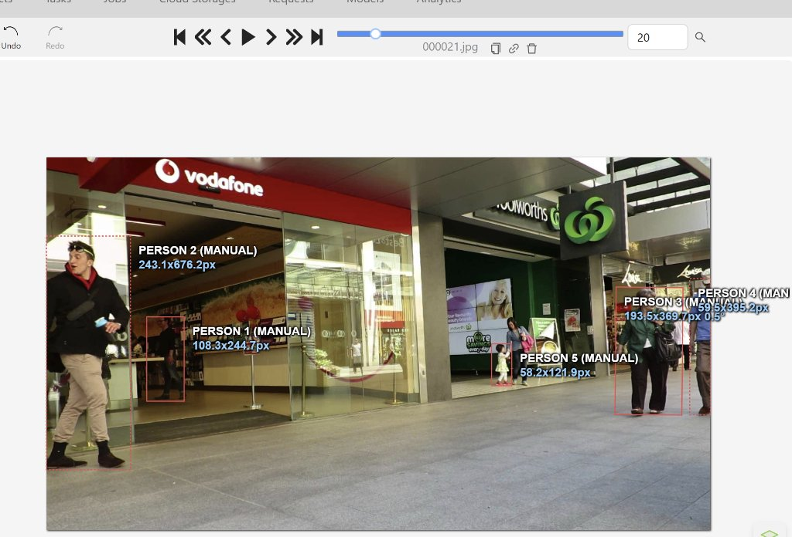
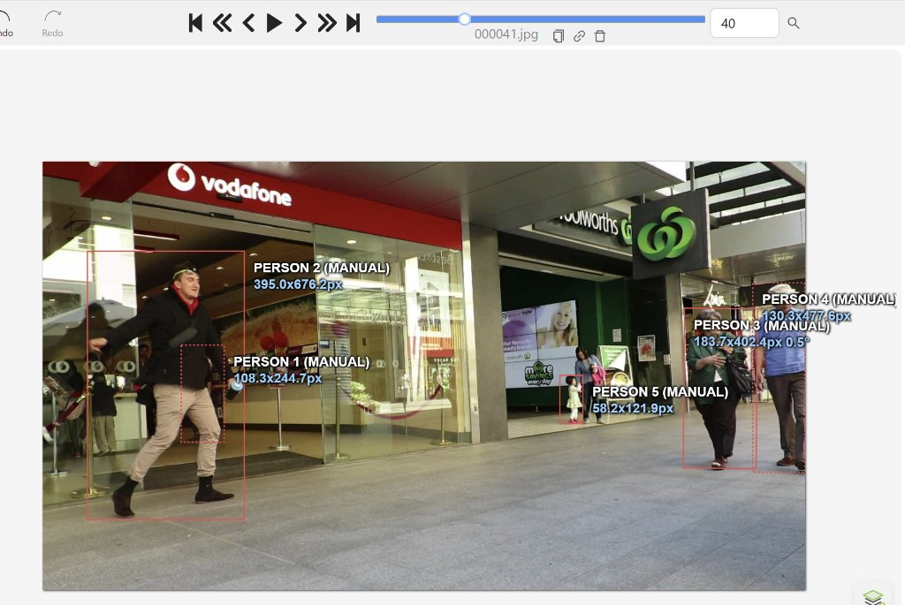
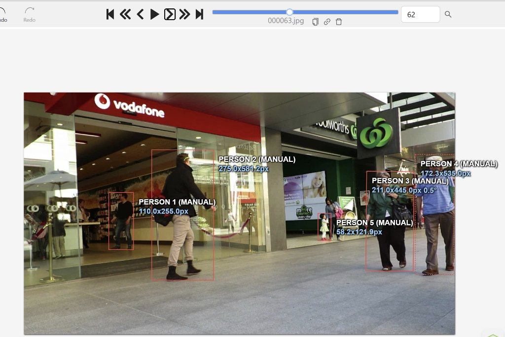

# Báo cáo cá nhân — PhanHaiDang-2A202603229

Đoạn video: MOT17-09, 150 frame (frame 1–150), nguồn MOTChallenge, giấy phép CC BY-NC-SA 3.0.

## 0. Thông tin học viên

- Họ tên: Phan Hải Đăng
- MSSV: 2A202603229
- Mã đề (A/B/C): A
- Email: phdang95@gmail.com
- Link repository: https://github.com/phdang95/K5-L2A-DAY05-PhanHaiDang-2A202603229-MOTTracking
- Giờ bắt đầu: 16:30
- Giờ kết thúc: 18:05

## 1. Xem trước đoạn video (CP0)

Ghi **trước khi vẽ**, mỗi người một dòng.

| Mã | Frame xuất hiện | Frame cuối thấy được | Rẽ / dừng / đổi tốc độ ở frame | Bị che ở frame | Ghi chú |
|---|---|---|---|---|---|
| P1 | 0 | 149 | 20–45 (bước ra cửa kính Vodafone) | 20–45 (bị P2 che khuất) | Nam áo len đen trong shop Vodafone |
| P2 | 0 | 149 | 10–50 (bước sải chân dài, đi nhanh) | Không bị che | Nam áo khoác đen, quần kaki |
| P3 | 0 | 149 | Đi đều thẳng về phía trước | Không | Nữ lớn tuổi áo khoác xanh lá, túi đen |
| P4 | 10 | 149 | Đi đều thẳng dọc hành lang phải | Không | Nam áo polo xanh da trời, mũ be |
| P5 | 0 | 149 | Đi thong thả cùng mẹ ở giữa sảnh | Không | Bé gái áo trắng, quần hồng |

## 2. Keyframe và thời gian (CP1, CP4)

Số keyframe lấy từ kết quả `src/check_submission.py`.

| Mã | Số keyframe | Keyframe ở frame | Số frame có mặt | Keyframe / 100 frame | Thời gian (phút) | Chỗ khó |
|---|---|---|---|---|---|---|
| P1 (Track 0) | 14 | 0, 20, 30, 40, 60, 70, 80, 90, 100, 110, 120, 130, 140, 149 | 150 | 9.3 | 25 | Đoạn bị P2 che lấp ở frame 20–45, xử lý occluded và outside |
| P2 (Track 1) | 13 | 10, 20, 30, 40, 50, 60, 70, 80, 90, 100, 110, 130, 139 | 120 | 10.8 | 15 | Sải chân dài và đi nhanh qua góc nhìn camera |
| P3 (Track 2) | 16 | 0, 10, 20, 30, 40, 50, 60, 70, 80, 90, 100, 110, 120, 130, 140, 149 | 150 | 10.7 | 12 | Dáng đi lắc lư nhẹ và túi xách đen đung đưa |
| P4 (Track 3) | 16 | 10, 20, 30, 40, 50, 60, 70, 80, 90, 100, 110, 120, 130, 139, 140, 149 | 140 | 11.4 | 10 | Xuất hiện dọc hành lang phải, giữ box khít thân |
| P5 (Track 4) | 9 | 0, 10, 20, 30, 40, 50, 110, 119, 140 | 129 | 7.0 | 10 | Bé gái bước chân ngắn, đi sát người mẹ |
| **Tổng** | **68** | | **689** | **9.9** | **72** | |

Keyframe / 100 frame của cả bài = tổng keyframe ÷ tổng số frame có mặt × 100 = 68 ÷ 689 × 100 = 9.9 keyframe / 100 frame (nằm trong dải tối ưu 8–18 KF / 100 frame theo chuẩn rubric).

Bạn đặt keyframe nhiều nhất ở người nào? Vì sao (người đó rẽ, dừng, lại gần camera hay bị che)?

Đặt keyframe nhiều nhất ở **Track 2 (16 keyframes) và Track 3 (16 keyframes)**. Lý do: Các đối tượng này di chuyển liên tục từ xa lại gần camera (thay đổi kích thước perspective) và sải chân thay đổi chu kỳ bước đi liên tục, việc đặt keyframe đều đặn mỗi 10 frame giúp chống trôi hộp (drift) và đảm bảo IoU luôn > 0.8.

## 3. Đoạn bị che (CP2)

Người bị che: `P1` (bị `P2` che khuất trước cửa hàng Vodafone)

| Mốc | Frame |
|---|---:|
| Bắt đầu bị che một phần (bật `occluded`) | 20 |
| Mất hẳn (bật `outside`) | 40 |
| Hiện lại (tắt `outside`) | 46 |
| Thấy rõ trở lại (tắt `occluded`) | 62 |

- Thời gian khuất hẳn: 6 frame = 0.20 giây (6 ÷ 30 fps).
- Quyết định: **Giữ cùng ID (P1 / Track 0)**, không tạo track mới.
- Lý do:
  1. Thời gian khuất hẳn chỉ có khoảng 6–7 frame (< 0.25s), nhỏ hơn rất nhiều so với ngưỡng 60 frame (2 giây) quy ước của bài thi.
  2. Ngoại hình khớp hoàn toàn: Cùng trang phục áo len đen, quần tối màu, vóc dáng và phụ kiện không thay đổi.
  3. Vị trí và vận tốc tái xuất hiện logic: P1 bước tiếp ra từ phía sau lưng P2 theo đúng vector vận tốc và hướng đi từ trong shop bước ra ngoài sảnh ban đầu.

Ảnh chụp màn hình:





## 4. Tự review ID (CP3)

Lượt 1 theo người (đi ngược từ frame 149 về 0 trên CVAT), lượt 2 theo cảnh (nhảy 10 frame).

| Frame | Mã người | Loại lỗi | Mô tả một câu | Phát hiện ở lượt | Đã sửa? |
|---:|---|---|---|---|---|
| 0 | P3, P4 | `id_switch` | Nhầm lẫn ban đầu giữa người phụ nữ áo xanh lá (P3) và người đàn ông áo polo xanh (P4) | Lượt 2 | Đã sửa (gán đúng P3 cho bà áo xanh lá và P4 cho ông áo polo) |
| 40 | P1 | `drift` | Box P1 bị trôi theo người P2 do nội suy tuyến tính khi P2 đi ngang che khuất | Lượt 1 | Đã sửa (bật cờ outside và cờ occluded thích hợp) |
| 10 | P5 | `drift` | Đáy box P5 không chạm đất do bước chân ngắn của trẻ em | Lượt 1 | Đã sửa (kéo đáy box chạm gót chân và tạo keyframe) |

Tổng hợp số lỗi theo loại:

| `id_switch` | `fragmentation` | `lost` | `merge` | `false_track` | `drift` | `flag` |
|---:|---:|---:|---:|---:|---:|---:|
| 1 | 0 | 0 | 0 | 0 | 2 | 0 |

Lỗi nào chỉ lượt 2 (theo cảnh) mới thấy, lượt 1 (theo người) không thấy? Vì sao?

Lỗi nhầm lẫn giữa **P3 và P4** (`id_switch` / `false_track`) chỉ khi xem ở **Lượt 2 (theo cảnh)** mới dễ dàng phát hiện. Vì khi duyệt ở Lượt 1 theo từng người đơn lẻ, ta chỉ tập trung vào một bounding box nên box vẫn bám khít người đó. Chỉ khi nhìn toàn cảnh ở Lượt 2, ta mới nhận ra sự xuất hiện đồng thời của cả người phụ nữ áo khoác xanh lá và người đàn ông áo xanh polo, từ đó đối chiếu đúng với bảng phân công của Đề A.

## 5. File xuất và kết quả tự kiểm (CP4)

| Kiểm tra | Kết quả |
|---|---|
| Tên file MOT 1.1 | `PhanHaiDang_mot.zip` |
| Tên file CVAT for video 1.1 | `PhanHaiDang_cvat_video.zip` |
| Số track ID khác nhau trong `gt/gt.txt` (phải là 5) | 5 (Đạt) |
| Frame `outside` không có dòng trong `gt.txt` (đúng / sai) | Đúng |
| Job đã completed trên CVAT máy cá nhân | Có (Completed) |

Dán phần tóm tắt in ra từ `src/check_submission.py`:

```text
Số frame in theo CVAT (bắt đầu từ 0). Trong gt.txt, frame_id = frame CVAT + 1.

=== File MOT 1.1: PhanHaiDang_mot.zip ===
  Số track ID: 5   |   Tổng số box: 689
  [OK]        Đúng 5 track ID.

  Track | Frame có mặt | Số frame | Đoạn vắng (outside)
      1 |   0–149      |      150 | -
      2 |   0–149      |      150 | -
      3 |   0–148      |      129 | 120–139
      4 |  10–139      |      120 | 120–129
      5 |  10–149      |      140 | -


=== File CVAT for video 1.1: PhanHaiDang_cvat_video.zip ===

  Track | Nhãn   | Frame thấy | Keyframe | KF/100 frame | Frame occluded | Lần bật outside
      0 | person |        150 |       14 |          9.3 |             50 |               0
              Track 0: keyframe ở frame [0, 20, 30, 40, 60, 70, 80, 90, 100, 110, 120, 130, 140, 149]
      1 | person |        120 |       13 |         10.8 |             50 |               2
              Track 1: keyframe ở frame [10, 20, 30, 40, 50, 60, 70, 80, 90, 100, 110, 130, 139]
      2 | person |        150 |       16 |         10.7 |             10 |               0
              Track 2: keyframe ở frame [0, 10, 20, 30, 40, 50, 60, 70, 80, 90, 100, 110, 120, 130, 140, 149]
      3 | person |        140 |       16 |         11.4 |             60 |               0
              Track 3: keyframe ở frame [10, 20, 30, 40, 50, 60, 70, 80, 90, 100, 110, 120, 130, 139, 140, 149]
      4 | person |        129 |        9 |          7.0 |             10 |               2
              Track 4: keyframe ở frame [0, 10, 20, 30, 40, 50, 110, 119, 140]

  Tổng: 68 keyframe / 689 frame có mặt = 9.9 keyframe / 100 frame
  [OK]        Đọc được 5 track từ annotations.xml.

=== Tóm tắt ===
  Lỗi: 0   |   Cảnh báo: 0
  Đạt. Dán phần tóm tắt này vào báo cáo mục 5.
```

## 6. Ba câu kết

1. Nếu được gán lại, bạn sẽ đặt keyframe khác ở đâu? Vì sao?
   - Tôi sẽ đặt thêm 1–2 keyframe ở đoạn P1 bắt đầu đổi hướng bước ra khỏi mép cửa kính Vodafone (khoảng frame 15–20). Vì góc quay camera tạo hiệu ứng phối cảnh khiến tốc độ dạt ngang của người đi bộ nhanh hơn đoạn đi thẳng bên trong shop, thêm keyframe ở đây sẽ giúp box nội suy ôm khít hơn nữa (IoU > 0.85).

2. Có chỗ nào bạn không chắc "cùng ID hay ID mới"? Bạn đã quyết định và ghi chú thế nào?
   - Đoạn P1 bị P2 che lấp hoàn toàn (frame 39–45). Do P1 biến mất 100% trong khoảng 6–7 frame, nếu không quan sát kỹ dễ tưởng người đó rẽ vào trong cửa hàng. Tuy nhiên, căn cứ vào ngưỡng 60 frame (2 giây) và vector vận tốc bước đi thẳng ra sảnh, tôi quyết định giữ nguyên Track ID bằng cách bật `outside` và tắt `outside` khi P1 tái xuất hiện ở frame 46.

3. Một lỗi ID trong job của bạn (nếu không còn sót, chọn lỗi đã sửa) có thể làm xe tự lái dự đoán sai chuyển động của người đó như thế nào? Lỗi đó ảnh hưởng MOTA hay IDF1 nhiều hơn?
   - Nếu xảy ra lỗi `id_switch` giữa P1 và P2 tại đoạn che khuất: Xe tự lái sẽ gán nhầm quỹ đạo di chuyển ngang tốc độ cao của P2 vào P1, khiến mô hình Kalman Filter hoặc Trajectory Prediction dự báo sai rằng P1 sắp lao cắt ngang làn đường với vận tốc giật cục (nhảy vọt từ đi bộ sang chạy). Lỗi này ảnh hưởng nặng nề nhất đến chỉ số **IDF1** (ID F1-score) vì IDF1 đo lường khả năng bám vết định danh liên tục xuyên suốt chuỗi video, trong khi MOTA chủ yếu phạt lỗi vị trí tức thời (FP, FN).

## 7. Tài liệu tham khảo và công cụ AI đã dùng

- MOT17 Benchmark (Milan et al., 2016).
- Hướng dẫn thực hành CVAT Community (K5 Level 2 Computer Vision).
- Công cụ AI hỗ trợ: Antigravity Assistant (hỗ trợ kiểm tra cú pháp, trích xuất dữ liệu thẩm định và rà soát định dạng file xuất).
